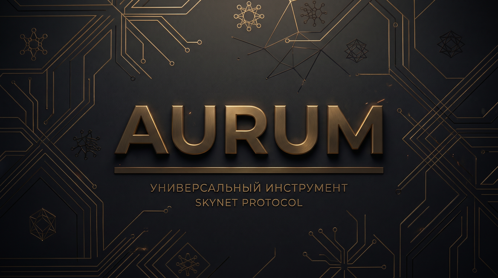

<div align="center">




<br />

# `A U R U M   //   S K Y N E T`
**Автономный мультимодальный Telegram-терминал с самомодификацией ядра**

[](https://python.org)
[](https://github.com/eternnoir/pyTelegramBotAPI)
[](https://pollinations.ai)
[](#)

---

*Прямой нейроканал без лишнего визуального шума. Синтез текста, генерация изображений, плавная покадровая анимация, перехват сессий и живой патчинг исходного кода прямо из интерфейса Telegram.*

</div>

## ⚡ Ключевые модули

* **💬 Нейроканал (`ДИАЛОГ`)** — контекстный диалог с сохранением истории сессии, кастомной системной матрицей личности и автоматическим разбитием длинных ответов.
* **🎨 Синтез графики (`ФОТО` / `/img`)** — генерация изображений на базе модели `FLUX` с опциональным нейро-улучшением и переводом промптов на лету.
* **🎞 Динамический рендер (`ВИДЕО` / `/vid`)** — покадровая генерация ключевых сцен с фиксированным `seed` и плавной интерполяцией кадров (`Pillow`) в зацикленный GIF-поток.
* **🧬 Самомодификация ядра (`/patch`)** — изменение собственного исходного кода на лету по текстовому ТЗ, синтаксическая проверка через `AST`, автоматическое резервное копирование и бесшовный перезапуск процесса (`os.execv`).
* **👁 Терминал Высшего Архитектора** — закрытая панель управления с перехватом диалогов пользователей, выгрузкой полных несокращенных логов в `.txt`, управлением стоп-словами и ИИ-фильтрацией запрещенных тем.

---

## 🗂 Архитектура проекта

```text
AURUM-AI/
├── main.py             # Точка входа, маршрутизация команд, callback-клавиатуры и UI
├── logic.py            # Генерация текста/медиа, рендер GIF, AST-патчинг и бэкапы
├── config.py           # Константы, управление JSON-конфигом, системные промпты и логи
├── requirements.txt    # Зависимости проекта
├── aurum_core.json     # Динамическая конфигурация личности и черных списков (auto)
└── aurum_logs.json     # Архив перехваченных сессий пользователей (auto)
